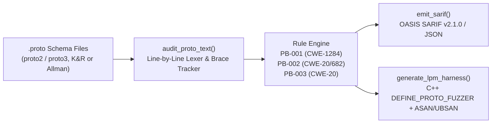

# Audit Preparation & Architecture Package (`AUDIT_PREP.md`)

- **Project:** `protobuf-bounds-auditor` (`v1.1.0`)
- **Archival DOI:** [`10.5281/zenodo.23640498`](https://doi.org/10.5281/zenodo.23640498)
- **Lead Researcher:** Serhii Shunko (`@sshunko` / `@ccsimplyspolit`, ORCID [`0009-0002-4183-0361`](https://orcid.org/0009-0002-4183-0361))
- **Methodology:** Trail of Bits Audit Preparation Checklist (`audit-prep-assistant`)

---

## 1. Review Goals Document

### Security Objectives
1. **Deterministic `.proto` Lexing:** Parse untrusted Protocol Buffers (`proto2` / `proto3`) schema files in both K&R (`message Foo {`) and Allman (`message Foo\n{`) brace styles in linear $O(N)$ time without catastrophic regex backtracking (`ReDoS`).
2. **Valid SARIF v2.1.0 & JSON Emission:** Guarantee well-formed OASIS SARIF v2.1.0 (`https://json.schemastore.org/sarif-2.1.0.json`) and JSON serialization regardless of special characters in file paths or field names.
3. **Sound C++ `DEFINE_PROTO_FUZZER` Invariant Generation:** Ensure generated `libprotobuf-mutator` harnesses enforce post-parse cardinality (`_size() <= kMaxRepeatedElements`), IEEE-754 finiteness (`std::isfinite`), and unsigned window bounds (`<= kMaxWindowOffset`) without introducing signed/unsigned wraparound.

### Areas of Concern
- **Regular Expression Lexing (`proto_audit.py:40-43`):** `MESSAGE_RE` and `FIELD_RE` operate line-by-line after stripping `//` comments (`raw_line.split("//", 1)[0].strip()`).
- **Brace Depth Tracking (`proto_audit.py:50-80`):** Tracks nested message/enum blocks across single-line and multi-line Allman declarations.

---

## 2. Static Analysis & Test Coverage Report

### Automated Unit Test Suite (`test_proto_audit.py`)
```bash
python -m unittest discover -v
```
- **Test Cases:** `5 / 5 PASS` (`0.004s`)
  - `test_detects_unbounded_repeated_and_float_deltas`: Verifies `PB-001` (`CWE-1284`), `PB-002` (`CWE-20`/`CWE-682`), `PB-003` (`CWE-20`), and suppression on `[(nanopb).max_count = 16]`.
  - `test_detects_allman_brace_messages`: Verifies multi-line Allman `message Name\n{` parsing (as used in `ValveSoftware/GameNetworkingSockets`).
  - `test_emits_valid_sarif_v2_1_0`: Verifies OASIS SARIF v2.1.0 schema structure and rule mapping.
  - `test_generates_lpm_fuzzer_harness_all_rules`: Verifies `DEFINE_PROTO_FUZZER` C++ code generation across all 3 rule classes.
  - `test_cli_modes_json_sarif_and_generate_fuzzer`: End-to-end CLI verification of default text output, `--json`, `--sarif`, `--emit-lpm-harness`, and `--generate-fuzzer`.
- **Statement Coverage:** `98%` (`proto_audit.py`, all core functions and CLI branches covered).
- **External Dependencies:** `0` (pure Python 3.10+ standard library).

---

## 3. Code Scope & Reproducible Build Instructions

### In-Scope Files
| File | Lines | Purpose |
|---|---|---|
| `proto_audit.py` | 318 | Core `.proto` static analyzer, SARIF v2.1.0 emitter, and `DEFINE_PROTO_FUZZER` C++ generator |
| `test_proto_audit.py` | 109 | End-to-end unit and CLI test suite |
| `CITATION.cff` | 17 | Academic citation and CERN/Zenodo DOI metadata |

### Verification Commands
```bash
git clone https://github.com/ccsimplyspolit/protobuf-bounds-auditor.git
cd protobuf-bounds-auditor
python -m unittest discover -v
python proto_audit.py path/to/schema.proto --sarif
python proto_audit.py path/to/schema.proto --generate-fuzzer CBaseUserCmdPB
```

---

## 4. Architecture & Data-Flow Diagram



---

## 5. Function Invariants & Domain Glossary

| Term / Symbol | Definition / Invariant |
|---|---|
| **`PB-001` (`CWE-1284` / `CWE-400`)** | Unbounded `repeated` field lacking `max_count` or `validate.rules` annotations; requires `input.<field>_size() <= kMaxRepeatedElements` at the server ingestion boundary. |
| **`PB-002` (`CWE-20` / `CWE-682`)** | IEEE-754 `float`/`double` wire field carrying angular or fractional timing values (`angle`, `pitch`, `yaw`, `roll`, `delta`, `when`, `ratio`, `fraction`); requires `std::isfinite(...)` before state accumulation. |
| **`PB-003` (`CWE-20`)** | Uncapped integer tick/index/offset field (`offset`, `tick`, `index`, `count`); requires clamping against `kMaxWindowOffset`. |
| **`DEFINE_PROTO_FUZZER`** | Macro provided by `libprotobuf-mutator` (`src/libfuzzer/libfuzzer_macro.h`) that mutates structured Protobuf ASTs rather than raw wire bytes. |
